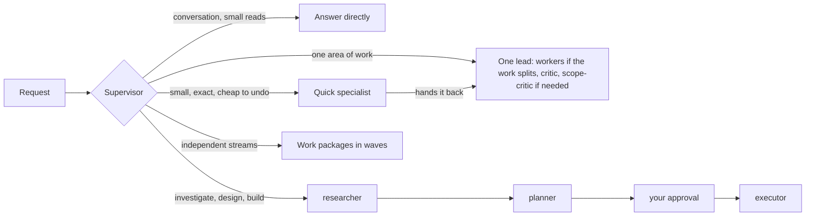
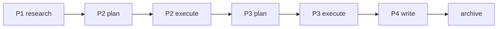
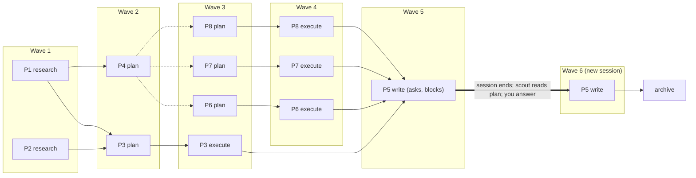

# Supervisor for Pi

Supervisor for Pi is the port of [Supervisor for Claude](https://github.com/sly2j/claude-supervisor) to the pi coding harness. It is a multi-agent orchestration layer for pi. It is centered around a single supervisor agent that dispatches tasks based on scope and complexity. The supervisor answers simple questions itself, sends small exact tasks to a fast, cheap agent, and gives larger work to a lead agent. The lead splits the work across parallel workers when it has several independent parts, otherwise does it itself, and has critic agents review the result for quality and scope.

*Status: version 0.x, during the port. The unit and integration suites run without model calls. On the `openai-codex` subscription, the live routing test scores 28 of 28, both end-to-end runs pass, and an agent-driven run of the setup in the pi TUI passes (see [docs/parity.md](docs/parity.md)). The owner's manual checklist is still pending.*

## What It's For

Supervisor for Pi is built for long-horizon software and scientific-research tasks: complex, multi-session work that benefits from a research-plan-execute loop and persistent short- and long-term memory. For smaller one-off tasks, plain `pi` is likely more effective. The install does not change plain `pi`: it keeps its settings, packages and sessions, and does not load the package.

- **Parallel work:** a plan splits large jobs into independent pieces (work packages) that run side by side (waves).
- **Project memory:** `.supervisor/` holds memory, committed or kept local, designed after project-management practice: long-term goals, mid-term task cards, and short-term plans, plus a decision log, facts, conventions, and approved lessons learned. Plan files hold state, so work resumes in a new session. See [Persistence And Memory](#persistence-and-memory).

## Quick Start

Requirements:
- pi 1.5.2 or newer, with a login or a provider API key for at least one model provider
- Node 22.19 or newer, on macOS or Linux with a POSIX shell (Windows is not supported)
- `git`, to clone and to update
- `python3` for the memory script, and `bash` and `zip` for `/project-backup`

The repository is private, so cloning needs access to it.

```bash
git clone git@github.com:sly2j/pi-supervisor.git
cd pi-supervisor
./install            # profile in ~/.config/pi-supervisor, launcher in ~/.local/bin
pi-supervisor        # first start: press Enter to run the setup wizard
```

The setup wizard maps the four model tiers to your models.

`install` ends by printing the commands to start, update and uninstall. It prints a WARNING if `~/.local/bin` is not on your `PATH`. To add it, run this, then open a new terminal (use `~/.bashrc` for bash):

```bash
echo 'export PATH="$HOME/.local/bin:$PATH"' >> ~/.zshrc
```

For other options, see [Choosing An Install](#choosing-an-install).

Notes:
- If `install` or the wizard prints an error, see [Troubleshooting](#troubleshooting).

## Using It

The pack is one supervisor, four leads for larger work, their workers, two reviewers, and a few quick specialists. Who handles what:
- `supervisor`: your session; routes requests, briefs agents, and reports back
- `researcher`: investigation, code tracing, literature; writes `.supervisor/working/research/research-*.md`
- `planner`: decision-and-outline plans, questions first, in `.supervisor/working/plans/plan-*.md`
- `executor`: code, tests, config, agent definitions, git conflicts, Python environments; works in a worktree and lands its change sets locally
- `writer`: scientific and technical prose, slide content, project docs
- `researcher-worker`, `planner-worker`, `executor-worker`, `writer-worker`: the parallel workers a lead dispatches; you never call them yourself
- `critic`, `scope-critic`: review a lead's result, for quality and, when needed, for scope creep
- `fixer`: small, exact edits; runs a given command; removes recorded test residue
- `curator`: closes out finished plans into memory and the archive; adds and archives tasks; handles "remember X" / "forget X" / "make this a project"
- `git-ops`: routine git with guardrails
- `scout`: read-only lookups

Just ask for what you want. The supervisor picks the path:

| Situation | Path | Why |
|---|---|---|
| Conversation, general advice, one or two small reads | The supervisor answers directly | Nothing to delegate |
| Fully specified, small, local, no design decision, cheap to undo | One quick specialist: `fixer`, `git-ops`, or `scout` | Cheapest path, no review loop |
| Specified and local, but it needs a design call or is not cheap to undo | One lead and one review round | Too much for a quick specialist, less than the full loop |
| Anything else in one area of work | One lead (`researcher`, `planner`, `executor`, or `writer`) with workers when the work splits, and review | Design judgment gets reviewed |
| Investigation, then design, then code | `researcher` -> `planner` -> your approval -> `executor` | You approve the plan before code is written |
| Streams that each need their own research, plan, or write stage | Work packages, run in waves | Independent streams run in parallel |
| "review this diff/plan/draft" | Reviewers only, no edits | You asked for a review |
| A quick specialist finds the task bigger than it looked | Re-routed to one lead, with the specialist's findings | The quick tier no longer fits |

To choose yourself, say "quick" or "just do it" for a quick specialist, or "full", "thorough", or "with review" for a lead.

Commands you run yourself:
- `/meeting-summary <transcript> [notes]`: minutes from a meeting transcript
- `/project-backup`: timestamped, verified zip backup with retention
- `/close-out [retry]`: tear down residue, record and archive what the work taught, and print the `Session state:` line
- `/pick-up [<plan path> | <card>...]`: resume a plan after `/new` or in a new session, or pick one or more tasks when none is live
- `document-extraction`, `email-extraction`: skills for the substance of a document or email thread, as notes to write from
- `/supervisor-config [status|doctor]`: run the setup wizard, show the setup, or check it (see [Choosing An Install](#choosing-an-install))
- `/supervisor [on|off]`: turn the supervisor off for the session, restoring your model, thinking level and tools, or back on
- `/supervisor-memory <externalize|link|status>`: keep a project's memory outside the repo (see [Persistence And Memory](#persistence-and-memory))

The full inventory, with tiers, thinking levels, workers, reviewers, and internal skills, is in [docs/architecture.md](docs/architecture.md#agents).

Terms you will meet in answers before any doc defines them:
- **Work package, wave, program:** a plan splits a large job into packages; the packages whose inputs are ready run together as a wave; a plan with packages is a program.
- **Residue:** what tests and smoke runs leave behind; recorded as it is made and removed at the end, so you see only what could not be removed.
- **`Session state:`** the last line after a close-out or a finished wave: whether `/new` is safe and how to resume ([key](docs/workflow-lifecycle.md#prompts-and-answers)).
- **`Run yourself:`** the one block at the end of an answer with the steps only you can run.
- **`not stored:`** the note you get outside a project when something would have been remembered ([details](docs/workflow-lifecycle.md#without-a-memory-store)).
- **Profile, launcher:** the install lives in its own pi agent directory (`~/.config/pi-supervisor`) and is started with `pi-supervisor`, which runs `pi` with `PI_CODING_AGENT_DIR` set to that directory.
- **Tier:** agents name one of four tiers (`top`, `strong`, `standard`, `fast`), not a model; the setup wizard maps each tier to a model.
- **Tracked, local, external store:** where a project's memory lives; see [Persistence And Memory](#persistence-and-memory).

## How It Works

**The full loop** (Mode 1 in [docs/architecture.md](docs/architecture.md#mode-1-the-full-loop)). The supervisor hands the task to a lead. The lead splits the work across parallel agents when it has several independent parts, otherwise does it itself, and has the result reviewed: `critic` checks quality, and when the findings or the result are large, `scope-critic` checks both for bloat and scope creep. The lead fixes what matters, up to three rounds (one for plans, since you review the plan next). A `REVIEW.md` at your repo root adds your own review rules.

**The quick tier** (Mode 2). Small edits, routine git, and read-only lookups go to a fast, cheap specialist with no review. If the task turns out bigger than it looked, the specialist hands it back and the supervisor re-routes it to a lead.



Every agent other than your session runs as a separate `pi` process, started by the package's `dispatch` tool on the model of its tier. It sees only its brief, not your conversation, and returns its last message as the report.

**Why this design.** Long contexts fail in known ways: a bad fact gets repeated, the model leans on its history over its training, extra tools and stale facts crowd out the task. These failures get worse as context accumulates over a long task or a long project history. Supervisor for Pi is built to counter these failures. Context quarantine and offloading are central to the design: the supervisor reads almost nothing, every lead and worker gets a fresh window and returns a capped report, and plans and research live in files. See [docs/context-engineering.md](docs/context-engineering.md) for the design rationale.

## Larger Work

Larger work runs as a chain: `researcher` -> `planner` -> your approval -> `executor`. The supervisor skips any stage that adds nothing; a bug with an obvious fix goes straight to `executor`. Plans and research land in your project's `.supervisor/working/` (`plans/plan-*.md`, `research/research-*.md`), so you can read and annotate them between steps; finished ones move to `.supervisor/archive/working/`.

A plan splits a large job into work packages when its streams each need their own research, plan, or write stage; plain parallel work stays a flat plan. Each package lists only the stages it needs and depends only on the packages whose output it consumes.

The supervisor runs packages in waves. Each wave runs, all at once, the next stage of every unblocked package whose dependencies are done. After each wave you see a status table of every package and the questions the leads raised. A question blocks its package until you answer, in this session or a later one; the plan file holds the state and a log of what ran and what is still open.

A chain, where each package consumes the one before it: six stages, six waves.



A graph: P4's plan splits it into P6, P7, and P8; P5 asks a question in wave 5 and blocks; in a new session you answer, and wave 6 re-runs P5.



How the plan file records its packages and its log, and what happens at close-out, is in [docs/architecture.md](docs/architecture.md#mode-1-the-full-loop).

## Workflow Lifecycle

Every piece of work ends the same way: temporary artifacts are torn down, what the project learned is recorded, and the supervisor closes with a `Session state:` line that says whether `/new` is safe and how to resume. Steps only you can run are collected in one `Run yourself:` block. [docs/workflow-lifecycle.md](docs/workflow-lifecycle.md) walks small, medium and large work through open, approval, close-out, starting a new session and resuming, with the prompts to type and the answers to expect.

## Persistence And Memory

Supervisor for Pi keeps a per-project memory store in `.supervisor/`, committed with the repo or kept local. Agents read it when they start work and keep it current as they go, so decisions, facts, conventions and lessons survive across sessions; a committed store also shows up in `git log`, can be reviewed in a pull request, and reaches your collaborators. On a project that runs for weeks, this keeps last week's decisions and a researcher's findings from being lost or rediscovered.

This is separate from your personal preferences, which stay out of the store. `.supervisor/` holds what the project itself needs to remember.

The memory model:

- **What is in it:** long-term entries in `memory/<kind>/` (decisions, facts, goals, conventions, and lessons; a lesson is recorded only after you approve it), mid-term task cards in `tasks/` (one card per task), and short-term plans and research in `working/`. Finished and superseded items move to `archive/`. `.supervisor/README.md` explains the layout.
- **How agents use it:** a lead reads the relevant entries when it starts. What you decide while a plan runs is written into the plan's log, so it survives `/new`. At close-out, `curator` turns what the work taught into long-term entries, archives the finished plans and research, and finishes the task cards.
- **Your controls:** tell supervisor to "remember X", to "forget X", or to "make this a project".
- **Tasks:** `/pick-up` lists open tasks, claims the ones you pick (quick fixes aside) and routes them as one request typed in. A session already in a linked worktree lists and claims there. You can also type "show tasks", "add a task: ...", "block <task>: <reason>", "release <task>" or "drop <task>"; finished tasks are in `.supervisor/history.md`. In a tracked store a claim shows to other clones once pushed, in a local store only to this checkout, and in an externalized store live to every linked checkout. A `.supervisor/roadmap.md` from an earlier version becomes tasks automatically.
- **Where it applies:** only in a project: a folder inside a git repository, or one that holds (or sits under one that holds) `.supervisor/`, `.pi/`, `AGENTS.md` or `CLAUDE.md`, or one you told supervisor to make a project. Your home directory never counts.
- **Tracked or local, your choice:** before creating the store in a git repo, supervisor asks once.
  - **Tracked:** committed with the rest of your repo, so the memory is part of the repo history, shows up in pull requests, and reaches collaborators and other checkouts; a worktree's store belongs to its branch and lands with it.
  - **Local:** listed in the repo's git exclude file (`.git/info/exclude`, never `.gitignore`) and never committed, so nothing of the workflow enters the repo, which suits open-source and shared repos; it works only in that checkout.
  - **External:** `/supervisor-memory externalize` (or `python3 <clone>/skills/project-memory/scripts/memory externalize` from a shell) moves a local store to a directory outside the repo that your linked worktrees share and that you can keep in your own git repo; see [docs/local-memory.md](docs/local-memory.md).

## Branches, Worktrees And Versions

In a git repo, `executor` works on its own branch in a worktree under `<repo>/.pi/worktrees/` and, when the checks pass, lands it locally as one squash commit. Nothing is pushed without your go-ahead. Quick edits, conflict resolution, environment repair, and repos with submodules work in the current checkout, as does anything you ask to run "in place". No version is created or bumped unless your repo opts in; a repo with no versioning is asked once, and the answer is recorded in `AGENTS.md` or `CLAUDE.md` (the one that exists, else `AGENTS.md`). A sentence in your repo's `AGENTS.md` or `CLAUDE.md` overrides any of these; there is no config file. The details are in [docs/architecture.md](docs/architecture.md#git-work).

Outside a project (see [Persistence And Memory](#persistence-and-memory)) nothing is persisted: no worktree, no version, no question.

## Choosing An Install

| Install | Where | Start it with |
|---|---|---|
| `./install` | Profile in `~/.config/pi-supervisor`, launcher in `~/.local/bin` | `pi-supervisor` |
| `./install --profile <dir> --prefix <p>` | Profile in `<dir>`, launcher in `<p>/bin` | `pi-supervisor` (`<p>/bin/pi-supervisor` when `<p>/bin` is not on `PATH`) |
| `pi install <clone>` | Plain pi's agent directory, no launcher (possible, not recommended) | plain `pi` |

- Supervisor for Pi installs by default into a profile: a private pi agent directory (`~/.config/pi-supervisor`) with its own launcher, settings, packages, sessions, and `models.json`. `./install` registers the clone there as a pi package that pi loads in place, so keep the clone where it is. `pi-supervisor` starts Supervisor for Pi and plain `pi` stays plain pi.
- By default the profile's `auth.json` is a link to plain pi's, so your existing logins work at once; the trade-off is that a `/login` or `/logout` in either one changes both. `--separate-login` gives the profile its own `auth.json` instead; run `/login` once inside `pi-supervisor`. `--shared-login` switches back to the link.
- `--profile <dir>` (default `~/.config/pi-supervisor`) puts the profile elsewhere; `--prefix <dir>` (default `~/.local`) puts the launcher in `<dir>/bin`.
- `install` records these choices in `.install.conf` in the clone (one install per clone), and every later run and update reuses them, so you never repeat an option. A run that would change a recorded choice says what changes, including a login it would delete, and asks first.
- With a direct `pi install <clone>` (possible, not recommended), plain `pi` becomes the supervisor in every session.

Agents do not name models. Each agent has one of four tiers, and the setup wizard (`/supervisor-config`) maps each tier to a model of any provider pi has credentials for:

| Tier | Agents |
|---|---|
| `top` | `supervisor`, `writer`, `scope-critic` |
| `strong` | `planner`, `researcher`, `critic`, `writer-worker` |
| `standard` | `executor`, `curator`, `executor-worker`, `planner-worker`, `researcher-worker` |
| `fast` | `fixer`, `git-ops`, `scout` |

The supervisor moves a single dispatch to another tier in three cases: `strong` for a `writer` on short, low-stakes prose, `strong` for an `executor` on difficult work, and `top` for a `planner` on programs and open designs. The wizard stores the mapping in `~/.config/pi-supervisor/pi-supervisor.json`; see [Model Tiers](docs/deploy.md#model-tiers).

Providers come from pi: a `/login`, a provider API key in your environment (which reaches both `pi` and `pi-supervisor`), or a custom provider in the profile's `models.json` (one defined for plain pi must be defined again there). A Claude subscription used through pi is billed as extra usage, per token, not from your plan's limits; the wizard shows pi's notice when this applies. See [docs/deploy.md](docs/deploy.md) for every install step and flag.

## Optional: A Second Model As Critic

By default the `critic` that reviews a lead's result runs on its tier (`strong`), so the work and its review usually come from the same provider. You can run that one agent on a model from another provider instead, so the work and its review come from different model families with different blind spots. Only the critic changes: `scope-critic`, the leads and the workers stay on their tiers.

It is off by default. The wizard offers it when two or more providers have credentials: pick a model from a provider other than the `top` tier's. That model then runs every `critic` dispatch; it is stored as `critic` in the configuration file. To change or remove it, run `/supervisor-config` again; `/supervisor-config status` shows the current critic model.

## Differences From Supervisor for Claude

- Agents name one of four tiers instead of a Claude model; the wizard maps tiers to models of any provider pi supports.
- There is no `codex-critic` script; an optional critic model from another provider replaces it.
- There is no transcript audit tool.
- The session reset is `/new`; pi has no `/clear`.
- Repo instructions are read from `AGENTS.md` alongside `CLAUDE.md`; `CLAUDE.local.md` is not handled.
- The commit trailer is `Co-Authored-By: Supervisor for Pi`.
- pi has no permission prompts, so the git safety rules are instructions the agents follow, not enforced gates.

## Documentation

In reading order:

- [docs/workflow-lifecycle.md](docs/workflow-lifecycle.md): what you type, what comes back, what is on disk, when `/new` is safe and how to resume. Read this before your first multi-session task.
- [docs/architecture.md](docs/architecture.md): every agent and skill, which tier and tools each has, what the pack does in git, and the memory layout. Read this when you want to know who did what.
- [docs/deploy.md](docs/deploy.md): the install runbook: the wizard, update, switch models, fix an install. Read this when installing on another machine, switching models, or when something broke; the Quick Start covers the first install.
- [docs/local-memory.md](docs/local-memory.md): keeping a project's memory outside the repo, shared across worktrees and machines. Read this when the repo cannot hold the store.
- [docs/context-engineering.md](docs/context-engineering.md): why it is built as one supervisor plus fresh-window agents and files, and what that asks of you. Read this when you wonder why it works this way.

## Maintaining An Install

To update, run one command, then restart `pi-supervisor`:

```bash
pi-supervisor update              # pulls the clone, installs again, updates the profile's packages
pi update                         # pi itself, shared by pi and pi-supervisor
```

Inside `pi-supervisor`:

```text
/supervisor-config status         # configuration path, tiers and their agents, critic model, supervisor state, web tools
/supervisor-config doctor         # PASS/WARN/FAIL checks on pi, Node, the configuration, the models and the tools
```

To remove the install:

```bash
pi-supervisor uninstall           # asks you to type pi-supervisor
./install --uninstall             # the same, from the clone; --yes skips the question
```

Uninstall needs no options: it reads the recorded prefix and profile. It removes the launcher, the record and the whole profile directory, with its configuration, sessions and packages. A linked `auth.json` is unlinked, not followed, so your pi logins stay; plain `pi` and any external memory store are left alone. See [Update](docs/deploy.md#update), [Doctor Checks](docs/deploy.md#doctor-checks) and [Uninstall](docs/deploy.md#uninstall).

## Troubleshooting

| Symptom | Fix |
|---|---|
| `pi-supervisor: command not found` | Add `~/.local/bin` (or `<prefix>/bin` for a `--prefix` install) to `PATH` |
| `install: pi not found on PATH; install pi 1.5.2 or later first` | Install pi, then re-run `./install` |
| `install: pi ... is older than 1.5.2` | Run `pi update`, then re-run `./install` |
| `exists and is not managed by pi-supervisor` | Move that file aside, or choose another `--prefix` |
| `is a plain pi agent directory; choose another` | Pass a `--profile` that is not `~/.pi/agent` or the directory in `PI_CODING_AGENT_DIR` |
| `No models with credentials` (wizard) | Run `/login` inside `pi-supervisor`, or export a provider key such as `OPENAI_API_KEY`; restart `pi-supervisor`, then run `/supervisor-config` |
| `install: not confirmed; nothing changed` | The run would have changed a recorded choice and was not confirmed. Re-run it and answer `y`, or pass `--yes` |
| `git pull failed` during `pi-supervisor update` | Fix the clone (for example commit or stash local changes there), then run `pi-supervisor update` again |
| `pi-supervisor: <clone> is missing` | The clone was moved or deleted. Clone the repository again and run `./install` there |
| Status line `supervisor: top model ... has no credentials` | The supervisor stays off. `/login`, set the provider key, or remap the tier with `/supervisor-config`; `/supervisor-config doctor` names the fix |
| Status line `<tier> has no credentials` | A dispatch to an agent of that tier fails. Fix it as above |
| Doctor `WARN web tools` | Run `/supervisor-config` and accept the `pi-web-access` install; if it says "installed; active after /reload", run `/reload` |
| Status line `supervisor: invalid config: ...` | Fix `pi-supervisor.json` or run `/supervisor-config`, then `/reload` and `/supervisor-config doctor` |

## Repository Layout

```
agents/             agent definitions (15)
skills/             skills (16)
extensions/         the extension: dispatch, tiers, persona, setup wizard, doctor, commands
install             installer and uninstaller (POSIX sh)
package.json        pi package manifest; its version field is the package version
tests/              install, agent and skill lint, memory script (pytest); extension logic (node --test)
docs/               workflow-lifecycle.md, architecture.md, context-engineering.md, deploy.md (install runbook), local-memory.md
CLAUDE.md           instructions for agents working in this repo
.supervisor/        project memory; tasks/ holds open work items, one card per task
LICENSE             Apache License 2.0
```

To edit the pack, follow [CLAUDE.md](CLAUDE.md).

## License

Licensed under the Apache License, Version 2.0. See [LICENSE](LICENSE).
